# VoxCPM2 OpenAI TTS + Voice Studio

A self-hosted text-to-speech service for **VoxCPM2** with two public faces:

- an **OpenAI-compatible `/v1/audio/speech` API** that existing tools (LiteLLM, Open WebUI,
  Hermes, the Wyoming bridge) can call unchanged; and
- **Voice Studio**, a browser UI for speaking, cloning voices from recordings, designing voices
  from text descriptions, managing languages and pronunciation, and checking the engine.

One container runs both the FastAPI app and the vLLM-Omni engine under s6. The engine listens only
on loopback; the app is the only network-facing process.

> **Authority:** [`SPEC.md`](SPEC.md) is the product specification and [`ui/`](ui/) is the visual
> reference. This README is the operator/developer guide for the current implementation.
> Implementation history and task briefs live in [`docs/`](docs/).

---

## Table of contents

1. [What it does](#what-it-does)
2. [Features](#features)
3. [Hardware and tested environment](#hardware-and-tested-environment)
4. [Architecture](#architecture)
5. [Quick start — local](#quick-start--local)
6. [Container deployment](#container-deployment)
7. [Configuration](#configuration)
8. [Voice Studio guide](#voice-studio-guide)
9. [API reference](#api-reference)
10. [Data, storage and backups](#data-storage-and-backups)
11. [Operations](#operations)
12. [Development and testing](#development-and-testing)
13. [Troubleshooting](#troubleshooting)
14. [VoxCPM2 reference](#voxcpm2-reference)
15. [Delivery notes](#delivery-notes)
16. [Project layout and documentation](#project-layout-and-documentation)

---

## What it does

VoxCPM2 is a tokenizer-free, diffusion-autoregressive TTS model (2B parameters, 48 kHz output,
30 languages). This project wraps it in a production-shaped service:

- callers send `{"model": "tts-1", "voice": "<library-name>", "input": "..."}` and get audio back;
- voice names resolve to a stored reference clip + transcript, which are sent to the engine inline;
- the Studio can create those voices by **cloning** a recording or **designing** one from a
  description;
- streaming, all common audio containers, language metadata, pronunciation respellings, queueing,
  warm-up, readiness and startup diagnostics are handled by the app.

The model itself needs **no language tag**: it detects the language from the input text. Language
selection in this app controls the tag on each voice, the filters and the test phrases — not how a
voice sounds.

---

## Features

| Area | Capability |
|---|---|
| OpenAI API | `POST /v1/audio/speech`, `GET /v1/models`, `GET /v1/audio/voices`; `wav`, `pcm`, `mp3`, `opus`, `flac`; streaming; bearer auth (`API_KEYS`, optional) |
| Voice Studio | Seven hash-routed screens: Speak, Voices, Clone, Design, Languages, Pronunciation, Engine |
| Voice cloning | Upload 3–30 s of clean speech (≤20 MB), optional STT transcription, consent gate, silence trim + peak normalize |
| Voice design | Describe a voice, pick 1–5 candidates, audition/select, save several voices from one set |
| Languages | 30-language engine set, per-install enabled set, default language, per-language test phrases, relabel/delete decisions on removal |
| Pronunciation | Respelling rules (whole word / after-number units), import/export/test, applied to `/v1` and Speak |
| Engine management | Live status, VRAM, RTF, first-audio latency, queue depth, warm-up and restart |
| Streaming | Raw s16le PCM to the browser, WAV/MP3/Opus/FLAC streaming for API clients; `X-Sample-Rate` drives playback |
| Reliability | 2 concurrent engine requests + 16 queued, then 429; warm-up gates `/ready`; startup page with live engine log/failure mapping |
| Data | Voices in Qwen3-compatible safetensors, takes as WAV, backups before destructive edits |
| Delivery | Tag-driven image build + automatic deployment, health-gated, with `.env`-pinned image tag |

---

## Hardware and tested environment

The reference deployment is the `vllm` host:

| Item | Tested value |
|---|---|
| GPU | NVIDIA RTX 3090, 24 GB, **shared** with `whisper-stt`, `tei-embed`, `tei-rerank` |
| Host GPU index | 1 (container sees it as device 0 via CDI) |
| Weights | `/models/openbmb/VoxCPM2`, ~4.7 GB, mounted read-only |
| Runtime | vLLM 0.30.0 + vLLM-Omni 0.30.0 + `voxcpm==2.0.3` |
| Engine concurrency | 2 sequences; app queue 16 |
| Measured engine VRAM | ~9.3 GB for the engine; ~14.5 GB used on the whole card with the other services |
| Warm speed | RTF ≈ 0.14; first streamed audio ≈ 154–285 ms |
| Cold start | first request ≈ 14.5 s; hidden by warm-up before `/ready` |
| Output | 48 kHz mono |
| Container | Podman, CDI GPU, `deploy/compose.yaml`, published on **8881** while Qwen3-TTS still owns 8880 |

Practical minimums:

- an NVIDIA GPU with **≥10 GB free VRAM** and a working CUDA/vLLM-Omni stack;
- enough disk for the ~4.7 GB model plus your voice/take data;
- Python **3.12**, `ffmpeg`/`ffprobe`, and a modern browser with Web Audio for the Studio.

CPU/RAM sizing is not benchmarked separately from the host above. VRAM and latency depend on the
model, batch size and what else shares the card.

---

## Architecture

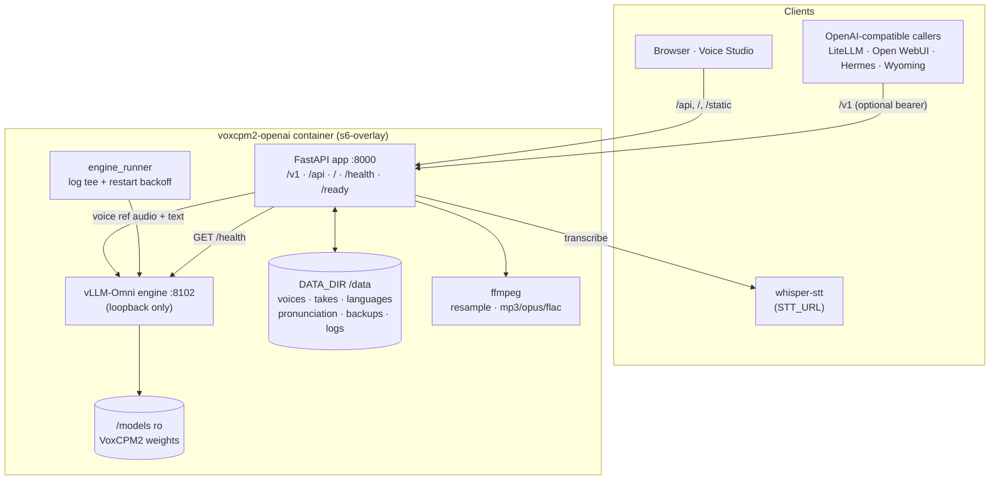

### Components

| Component | Responsibility |
|---|---|
| **FastAPI app** (`app/`) | Public surface, voice resolution, queueing, audio re-encoding, Studio API, startup/readiness |
| **Engine client** (`app/engine.py`) | Loopback HTTP client, health polling, 2-slot semaphore + bounded queue, streaming format/rate parsing, RTF metrics |
| **Engine runner** (`app/engine_runner.py`) | Supervises `vllm serve`, tees logs to `/data/logs/engine.log`, forwards signals, applies restart backoff |
| **vLLM-Omni engine** | Loads VoxCPM2, accepts speech requests with inline reference audio or description control text |
| **Voice/take stores** (`app/store.py`) | Safetensors voices + `voices.json`; session-scoped WAV takes + JSON metadata; backups |
| **Languages** (`app/languages.py`) | Supported set (30) from `deploy/supported-languages.json`; enabled/default/presets in `data/languages.json` |
| **Pronunciation** (`app/pronunciation.py`) | Respelling rules in `data/pronunciation.json`, applied before synthesis |
| **Startup tracker** (`app/startup.py`) | Four-step startup progress, merged log tail, failure mapping, `/api/engine/startup` |
| **Studio UI** (`app/static/`) | Plain HTML/CSS/ES modules; no build step and no CDN JS |

### Request path

1. A caller resolves a voice name to its safetensors reference audio + transcript (or supplies an
   ad-hoc `ref_audio` data URI).
2. Pronunciation rules rewrite the text; style control is applied as VoxCPM2’s `(instruction)text`.
3. The engine client waits for a free slot, forwards the text and reference audio to
   `127.0.0.1:8102`, and enforces the queue limit.
4. The app re-encodes (ffmpeg for mp3/opus/flac or resampling), adds response headers, and either
   returns bytes or relays the stream.
5. Streamed engine responses are requested as **raw WAV** (`stream_format: "audio"`), the header is
   parsed/stripped, float32 is converted if needed, and the client gets s16le at the advertised
   `X-Sample-Rate`.

---

## Quick start — local

Prerequisites: Python 3.12, `ffmpeg`, and optionally an engine at `http://127.0.0.1:8102`.

```bash
git clone git@gitlab.dotslash.io:jimmy/voxcpm2-openai.git
cd voxcpm2-openai

python3 -m venv .venv
.venv/bin/pip install -e '.[dev]'
```

Run the app (development data dir, local or tunnelled engine):

```bash
mkdir -p dev-data
DATA_DIR="$PWD/dev-data" \
ENGINE_URL="http://127.0.0.1:8102" \
SUPPORTED_LANGUAGES_FILE="$PWD/deploy/supported-languages.json" \
.venv/bin/uvicorn app.main:app --host 127.0.0.1 --port 8000
```

Open <http://127.0.0.1:8000>. Until the engine is warm, `/` shows the startup page and reports
progress/failures; `/health` stays 200 and `/ready` is 503.

Without a GPU engine the UI and APIs load, but synthesis returns 503. The test suite uses
`tests/fake_engine.py`, a deterministic in-process engine with the same HTTP shape.

Quality gate:

```bash
scripts/verify.sh          # format, lint, types, unit+integration, e2e, build, package contract
scripts/verify.sh --fast   # skip browser e2e
```

---

## Container deployment

### Build and run

```bash
docker build -f deploy/Containerfile -t voxcpm2-openai:dev .
```

Run with CDI GPU, weights and a state directory:

```bash
docker run -d --name voxcpm2-openai \
  --device nvidia.com/gpu=GPU-79ad6f3b-cc71-90a6-2430-286e1c6c9ec2 \
  --shm-size 8g \
  -p 8881:8000 \
  -v /models:/models:ro \
  -v "$PWD/data:/data" \
  voxcpm2-openai:dev
```

`deploy/compose.yaml` is the supported compose file. It reads the image tag from `.env`:

```bash
# on the target host, in /opt/voxcpm2-openai
printf 'VOXCPM2_IMAGE=harbor.dotslash.io/dotslash/voxcpm2-openai:v0.3.14\n' > .env
podman-compose -f compose.yaml up -d --force-recreate --pull
curl -fsS http://127.0.0.1:8881/ready
```

`./data` is relative to the compose file’s directory. On the reference host that is
`/opt/voxcpm2-openai/data`; keep that path in backups and restores.

### CI/CD

- `build` runs **only on `vX.Y.Z` tags** and pushes `:vX.Y.Z` plus `:latest` to
  `harbor.dotslash.io/dotslash/voxcpm2-openai`.
- `deploy` runs after a tag build: ssh to `deploy@vllm.dotslash.io` with `DEPLOY_SSH_KEY`, logs in
  to Harbor over stdin, updates `VOXCPM2_IMAGE` in `/opt/voxcpm2-openai/.env`, and recreates the
  container from the host's `compose.yaml` with `podman-compose`. It then waits for `/ready`.
- Branch pushes create no pipeline.

Required protected CI variables: `HARBOR_USER`, `HARBOR_TOKEN`, `DEPLOY_SSH_KEY`
(`base64 -w0` of the key authorized for `deploy@vllm`). The release tag must be protected so the
variables are available to tag pipelines.

Release:

```bash
git tag -a v0.3.15 -m "voxcpm2-openai 0.3.15"
git push origin v0.3.15
```

---

## Configuration

All values are environment variables (or keys in the compose `.env`). Defaults are in
`app/config.py`; the compose file shows the deployment values.

| Variable | Default | Purpose |
|---|---|---|
| `DATA_DIR` | `/data` | Voices, takes, languages, pronunciation, backups, logs |
| `MODEL_PATH` | `/models/openbmb/VoxCPM2` | Local VoxCPM2 weights |
| `ENGINE_URL` | `http://127.0.0.1:8102` | Loopback vLLM-Omni endpoint |
| `ENGINE_PORT` | `8102` | Engine port inside the container |
| `DEPLOY_CONFIG` | `/opt/app/deploy/voxcpm2-3090.yaml` | vLLM-Omni deploy config |
| `SUPPORTED_LANGUAGES_FILE` | `deploy/supported-languages.json` | Engine language set (30 for VoxCPM2) |
| `STT_URL` | *(empty)* | OpenAI-compatible whisper base ending in `/v1`; empty disables transcription |
| `STUDIO_AUTH` | *(empty)* | `user:password` HTTP Basic for `/`, `/api/*`, `/static/*` |
| `API_KEYS` | *(empty)* | Comma-separated bearer tokens for `/v1/*` |
| `ENGINE_CONCURRENCY` | `2` | Max simultaneous engine requests |
| `MAX_QUEUE` | `16` | Waiting requests before HTTP 429 |
| `SAMPLE_RATE` | `48000` | Default output rate |
| `TAKE_RETENTION` | `50` | Newest takes retained on disk |
| `MAX_UPLOAD_BYTES` | `20000000` | Clone upload cap (20 MB) |
| `ALLOW_REMOTE_REF_AUDIO` | `0` | Allow http(s) `ref_audio` URLs (SSRF-sensitive) |
| `HF_TOKEN` | *(empty)* | Optional Hugging Face token for cache-miss downloads |
| `HF_HUB_OFFLINE` | `1` | Keep Hugging Face offline; set `0` to allow downloads |
| `STARTUP_PAGE` | `1` | Serve the startup page until warm |
| `STARTUP_FAIL_AFTER_S` | `600` | Startup failure timeout |
| `LOUDNESS_TARGET_DB` | `-20` | Speech level (gated RMS, dBFS) every non-streamed clip is scaled to, peaks capped at -1 dBFS; `off` sends the engine's level unchanged (Q-027) |
| `VOXCPM2_CFG_VALUE` | *(engine default 2.0)* | Guidance for every request; read at engine start |
| `VOXCPM2_INFERENCE_TIMESTEPS` | *(engine default 10)* | Diffusion steps for every request; read at engine start |

`VOXCPM2_*` are engine-start settings: change them in `.env` and restart/recreate the container.
They are not per-request UI sliders.

Auth examples (never commit real values):

```bash
STUDIO_AUTH='admin:change-me'
API_KEYS='key-one,key-two'
```

---

## Voice Studio guide

The Studio is served at `/`; use the hash tabs to navigate. On a cold start, `/` is the startup
page first.

### Startup

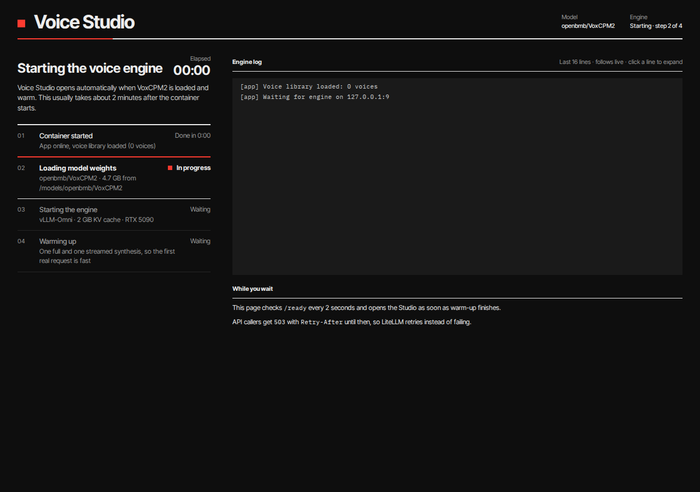

The page shows four steps (container → weights → engine → warm-up), elapsed time, the live merged
engine/app log, and a Restart button. `/api/*` is gated with 503 while starting (except startup
state and restart); `/v1` also returns 503 until warm. On failure it shows a plain-language cause
and the retry countdown.

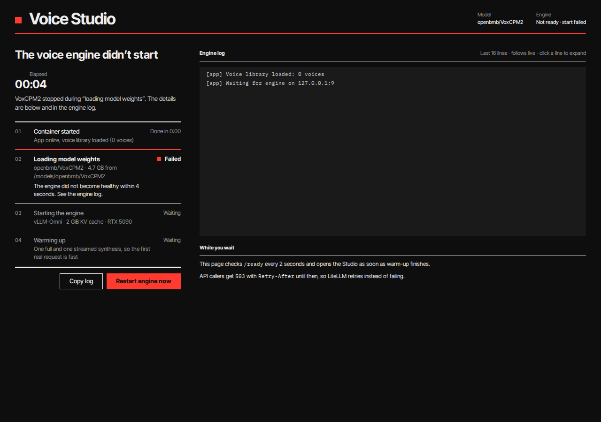

### 01 Speak

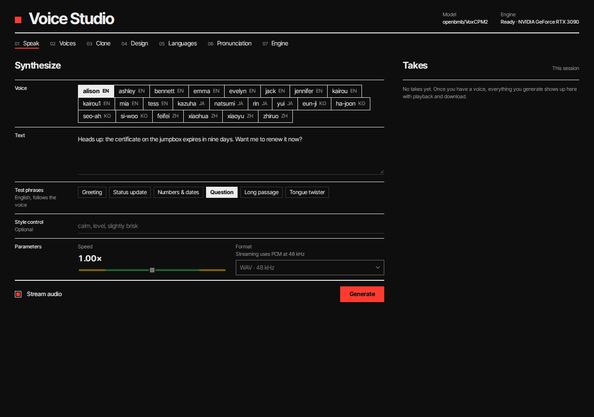

- Voice chips, with the last voice remembered in localStorage.
- Text plus per-language **test phrases** from the Languages configuration.
- Optional style control (VoxCPM2 `(instruction)text` syntax), speed (0.85–1.15×) and output
  format. Speed is applied with ffmpeg for non-streamed audio; streaming is PCM and does not apply
  speed.
- Stream toggle: audio starts on the first chunk and the take row follows the playhead.
- Takes are session-scoped: a reload starts an empty list, while old takes remain on disk (50
  retained). Play/pause, waveform progress, Download; no “Save as voice” in Speak.
- Empty library: a notice with Clone/Design buttons and a disabled Generate.

Mobile layout:

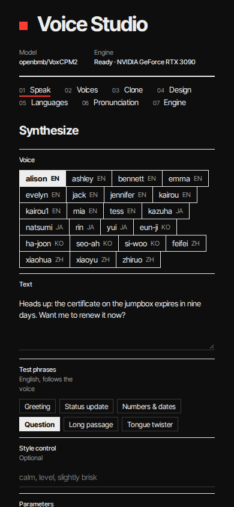

### 02 Voices

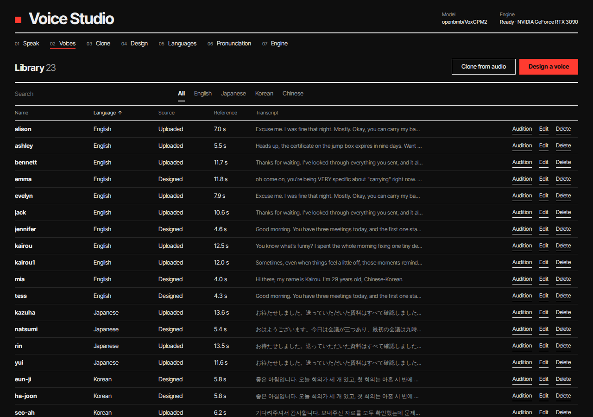

Search and language filters, source markers, reference length and one-line transcripts. Edit opens
an aligned in-row editor (name, language, transcript, Auto-transcribe), Delete confirms in place and
writes a backup first. Voices with a language no longer supported by the engine are marked and
blocked in Speak.

### 03 Clone

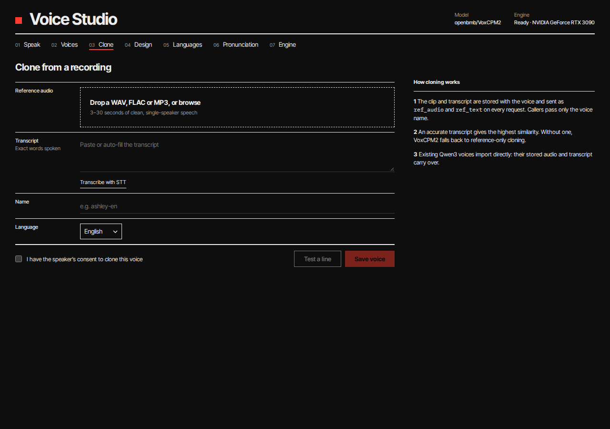

Drop or pick a 3–30 s WAV/FLAC/MP3 (≤20 MB), add the exact transcript (or “Transcribe with STT”),
validate the name live, tick consent, then Save voice. “Test a line” synthesizes a preview with the
uploaded clip without saving a voice.

### 04 Design

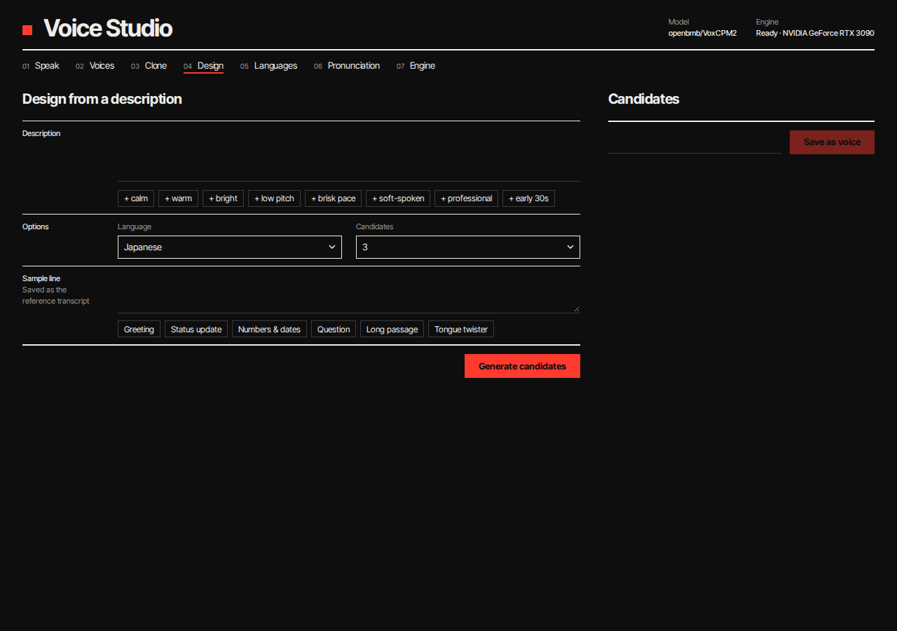

Describe the voice (optionally append descriptor tags), choose language and 1–5 candidates, and
generate. Each candidate has a seed, player and waveform; select one and save it as a voice. The set
stays so more candidates can be saved under different names. Design previews are peak-normalized for
consistent loudness.

### 05 Languages

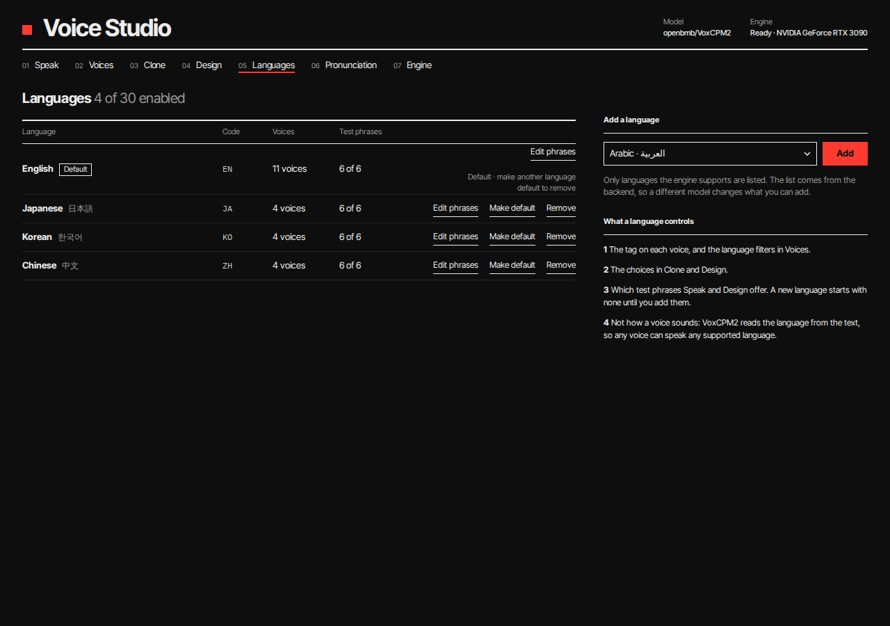

VoxCPM2 supports 30 languages; a new install enables English, Japanese, Korean and Chinese.
Languages control voice tags, Voices filters, Clone/Design choices and test phrases — never how a
voice sounds. Add supported languages, make one default, edit its test phrases, or remove one:
removal with voices in use requires relabelling them to another enabled language or deleting them,
and always backs up first. Drift (an enabled language no longer in the engine set) is shown and
blocks Speak until relabelled/removed.

### 06 Pronunciation

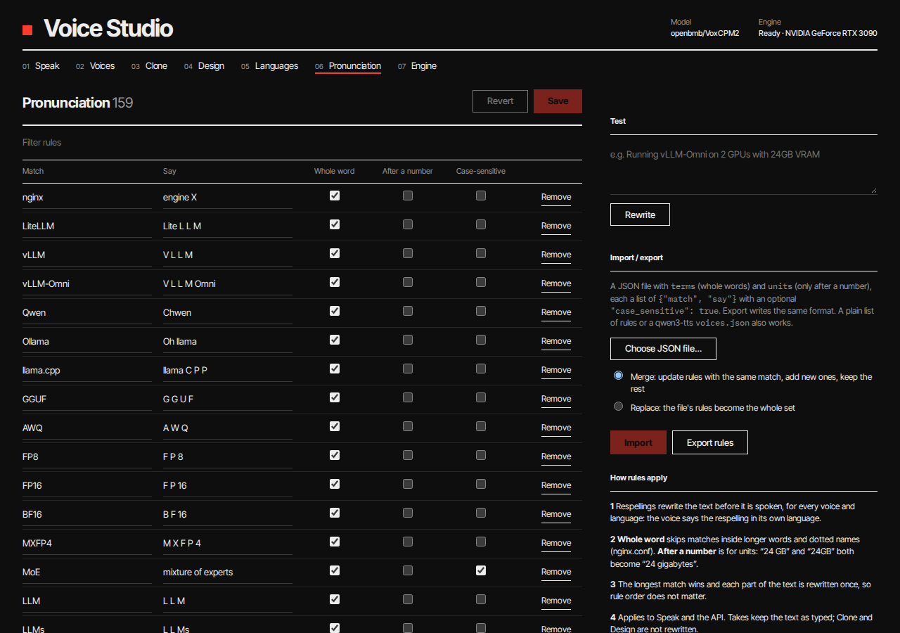

Respelling rules turn written forms into speakable ones (`nginx` → “engine X”). Rules can be whole
word, case-sensitive, or units that only apply after a number (`24 GB`). The screen supports add/
remove, import/export (including the qwen3-tts `voices.json` format), and a live test. Rules apply
to `/v1/audio/speech` and Speak, not to Clone/Design transcripts.

### 07 Engine

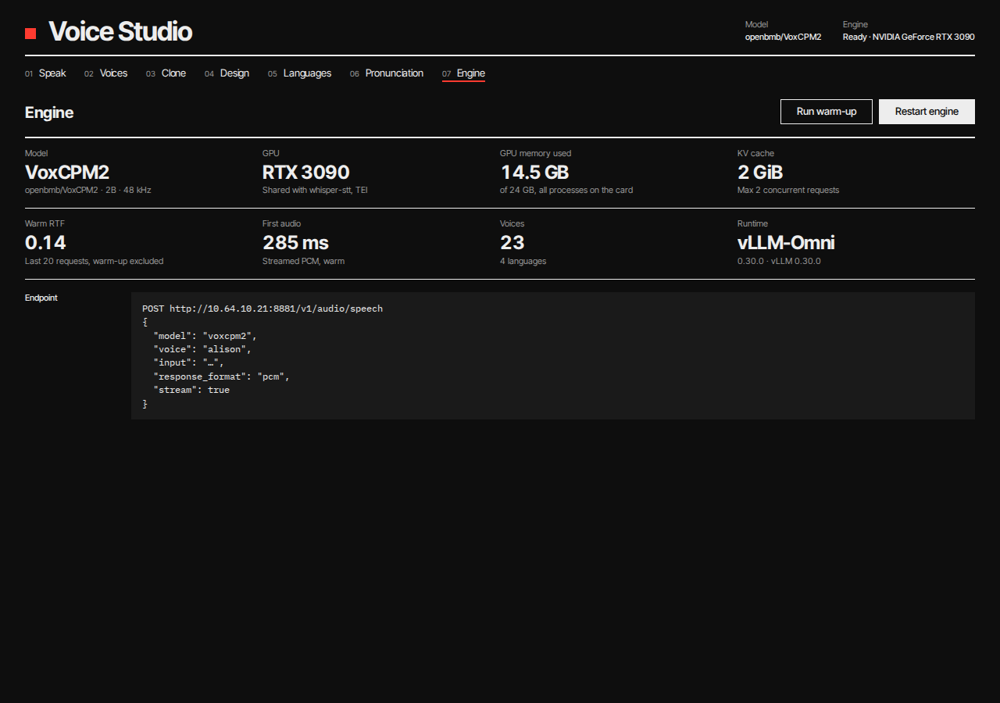

Live model/runtime, GPU, whole-card VRAM, KV cache, rolling warm RTF, first-audio latency, voice
count and queue depth. Run warm-up or restart the engine (confirm in place); the endpoint example
uses the current origin.

---

## API reference

Base URL: `http://vllm.dotslash.io:8881` (or your deployment). Studio auth, when configured, applies
to `/` and `/api/*`; `API_KEYS`, when set, applies to every `/v1/*` route except health/readiness.

### OpenAI-compatible

```bash
# WAV
curl -fsS http://vllm.dotslash.io:8881/v1/audio/speech \
  -H 'Content-Type: application/json' \
  -d '{"model":"tts-1","voice":"alison","input":"Hello from VoxCPM2.","response_format":"wav"}' \
  -o hello.wav

# Streamed raw PCM (s16le, 48 kHz)
curl -fsS -N http://vllm.dotslash.io:8881/v1/audio/speech \
  -H 'Content-Type: application/json' \
  -d '{"model":"voxcpm2","voice":"alison","input":"Streaming test.","response_format":"pcm","stream":true,"sample_rate":48000}' \
  -o hello.pcm

curl -fsS http://vllm.dotslash.io:8881/v1/models
curl -fsS http://vllm.dotslash.io:8881/v1/audio/voices
```

Fields: `model` (any accepted string), `input` (≤4000 chars), `voice` (library key,
case-insensitive), `response_format` (`wav|pcm|mp3|opus|flac`), `stream`, `instructions` (style),
`speed` (0.5–2.0), `sample_rate`, `ref_audio`/`ref_text` (ad-hoc clone), `seed`, `cfg`, `steps`.
Unknown voices are a 400 listing valid names. Errors use the OpenAI shape:

```json
{"error":{"message":"...","type":"...","param":null,"code":"..."}}
```

Statuses: 400 invalid input, 401 bad key, 429 queue full (`Retry-After`), 503 engine warming
(`Retry-After`).

### Studio / management API

| Method | Path | Purpose |
|---|---|---|
| GET/PATCH/DELETE | `/api/voices`, `/api/voices/{key}` | list/update/delete voices; audio at `/api/voices/{key}/audio` |
| POST | `/api/voices/clone` | multipart clone (consent required) |
| POST | `/api/transcribe` | `{text}` via `STT_URL` |
| POST | `/api/speak` | Studio synthesis; `save=false` returns audio without a take |
| GET/DELETE | `/api/takes`, `/api/takes/{id}/audio`, `/wave` | session takes, audio, 72-bucket envelope |
| POST | `/api/design/candidates`, `/api/design/save` | voice design |
| GET/POST/PATCH/DELETE | `/api/languages…` | enabled/default/remove, `/supported`, `/{code}/presets` |
| GET/PUT/POST | `/api/pronunciation…` | rules, import, export, test |
| GET | `/api/engine` | status/VRAM/RTF/queue |
| POST | `/api/engine/warmup`, `/restart` | warm-up, supervised restart |
| GET | `/api/engine/startup` | startup steps, log tail, failure mapping |
| GET | `/health`, `/ready` | liveness, warm readiness |

The full request/response contract is in [`docs/CONTRACTS.md`](docs/CONTRACTS.md).

---

## Data, storage and backups

`DATA_DIR` (default `/data`):

```
voices/<voice_name_lower>.safetensors   float32 mono audio + string metadata
voices.json                             ordering, display metadata, cached durations
takes/<id>.wav + <id>.json              session takes, WAV + metadata
languages.json                          enabled/default languages and test phrases
pronunciation.json                      respelling rules
settings.json                           defaults
backups/*.zip                           snapshots before destructive voice changes
logs/engine.log                         merged engine/app startup log
```

Voice files keep the Qwen3-compatible safetensors layout (`audio` tensor, `name`,
`voice_name_lower`, `ref_text`, `sample_rate`, `consent`, `language`, `source`, etc.), so existing
tooling can inspect them. New voices are created through the Studio; the old Qwen3 import path is
gone.

Back up the whole data directory before upgrades/cutover:

```bash
mkdir -p /backup
tar czf /backup/voxcpm2-data-$(date +%F).tar.gz -C /opt/voxcpm2-openai data
```

The app also writes its own voice/language backups before edits and deletes; oldest backups are
pruned.

---

## Operations

| Task | Command / endpoint |
|---|---|
| Liveness | `curl -fsS http://127.0.0.1:8881/health` |
| Warm readiness | `curl -fsS http://127.0.0.1:8881/ready` |
| Startup state | `curl -fsS http://127.0.0.1:8881/api/engine/startup` |
| Engine metrics | `curl -fsS http://127.0.0.1:8881/api/engine` |
| Logs | `podman logs -f voxcpm2-openai`; startup log at `data/logs/engine.log` |
| Warm-up | `POST /api/engine/warmup` or Engine screen |
| Restart engine | `POST /api/engine/restart` or Engine screen; s6 backs off 30/60/120 s on crashes |
| Deploy a release | push a `vX.Y.Z` tag; CI builds/deploys and waits for `/ready` |
| Manual deploy | update `VOXCPM2_IMAGE` in `/opt/voxcpm2-openai/.env`, `podman-compose up -d --force-recreate --pull` |
| Rollback | stop the new container, start `qwen3-tts-openai`, point LiteLLM back; or deploy a previous image tag |
| Validate | `scripts/verify.sh`; `scripts/smoke.sh` against a running deployment |

Cutover from Qwen3 (port 8880) is optional and documented in
[`docs/RUNBOOK.md`](docs/RUNBOOK.md): stop Qwen3, move VoxCPM2 to 8880, check LiteLLM/Open
WebUI/Hermes/Wyoming, keep `/opt/qwen3-tts` for rollback.

---

## Development and testing

```bash
.venv/bin/python -m pytest tests -q                 # unit + integration (fake engine)
.venv/bin/python -m pytest tests/e2e -q             # Chromium UI e2e
.venv/bin/ruff check app tests scripts
.venv/bin/mypy app
scripts/verify.sh                                   # the full local gate
```

The test suite uses `tests/fake_engine.py` with the real HTTP shape (WAV/PCM, streaming, 429s); it
does not need a GPU. Browser tests run the app against that fake engine and save screenshots under
`test-results/`.

Project layout:

```
app/                 FastAPI app, stores, engine client, startup/pronunciation/languages
app/static/          Studio HTML/CSS/ES modules, presets, icons
deploy/              Containerfile, compose, vLLM-Omni config, s6 services, language set
tests/               unit, integration, acceptance and Playwright e2e
docs/                plan, contracts, milestones, runbook, task briefs, screenshots
scripts/             verify.sh, smoke.sh, spike scripts
SPEC.md              product specification (authoritative)
ui/                  static visual reference
```

---

## Troubleshooting

| Symptom | Likely cause / fix |
|---|---|
| `/` stays on the startup page | Engine not warm: check `data/logs/engine.log`, GPU/CDI device, `/models` mount, VRAM. The page shows the mapped failure and can restart. |
| `/ready` 503 | Warm-up has not completed or the engine died. `/api/engine/startup` and `podman logs` show why. |
| `/v1` 503 with `Retry-After` | Still warming or restarting; retry. |
| 429 on `/v1` | Queue full (2 active + 16 waiting). Retry after the header; reduce burst size. |
| 400 `no_voices` | The library is empty; create a voice in Clone/Design, or pass `ref_audio`. |
| Unknown voice 400 | The `voice` field is the library **key** (lowercase), not the display name. |
| Language not enabled / unsupported | Add it in Languages; unsupported-by-engine voices are blocked in Speak. |
| Auto-transcribe disabled/503 | `STT_URL` is unset or unreachable. |
| Streamed audio sounds like static | Ensure the deployment is current (`stream_format=audio`); raw PCM is s16le at `X-Sample-Rate`. |
| UI still looks old after deploy | Static assets now send `Cache-Control: no-cache`; hard-reload the tab once. |
| CUDA out of memory | The card is shared. Lower other GPU workloads or reduce engine memory settings; restart after freeing VRAM. |
| Voice sounds different across runs | VoxCPM2 generation is stochastic; use a fixed `seed` for repeatability and expect some variation. |

---

## VoxCPM2 reference

**VoxCPM2** is OpenBMB’s tokenizer-free, diffusion-autoregressive TTS model:

- 2B parameters, **48 kHz** output, trained on multilingual speech;
- **30 languages**, language inferred from the text — no language tag is sent;
- **Voice cloning** from reference audio (with or without its transcript);
- **Voice design** from a natural-language description;
- style/emotion/pace control through the text prefix;
- strong context-aware prosody for long-form input.

Authoritative links:

- Model card: <https://huggingface.co/openbmb/VoxCPM2>
- Upstream repository: <https://github.com/OpenBMB/VoxCPM>
- Serving stack: [vLLM-Omni](https://github.com/vllm-project/vllm-omni) (0.30.0 here)
- Local weights: `/models/openbmb/VoxCPM2`; `voxcpm==2.0.3`

### How this app uses VoxCPM2

| Intention | What the app sends |
|---|---|
| Normal speak / `/v1` | `input` text + the resolved voice’s reference audio (`ref_audio`) and `ref_text` |
| Ad-hoc clone | caller-provided `ref_audio` + `ref_text` |
| Style control | `(style instruction)text` — VoxCPM2’s controllable-cloning syntax |
| Voice design | `(description)sample text` with no reference audio, plus a per-candidate `seed` |
| Language | Only a metadata label and preset choice; the model detects language from the text |

Supported-language set (30): Arabic, Burmese, Chinese, Danish, Dutch, English, Finnish, French,
German, Greek, Hebrew, Hindi, Indonesian, Italian, Japanese, Khmer, Korean, Lao, Malay, Norwegian,
Polish, Portuguese, Russian, Spanish, Swahili, Swedish, Tagalog, Thai, Turkish, Vietnamese. The
authoritative list lives in `deploy/supported-languages.json`.

Model-specific caveats:

- The first request after start is slow (~14.5 s); the app warms up before `/ready`.
- The reference deployment shares the 3090 with other services; ~10 GB free VRAM is required.
- Generation is stochastic; seeds make comparisons repeatable but timbre/pace can vary slightly.
- CFG and diffusion steps are engine-start settings (`VOXCPM2_CFG_VALUE`,
  `VOXCPM2_INFERENCE_TIMESTEPS`), not per-request UI controls.

---

## Delivery notes

- **Current release:** `v0.3.14` (`main`), image
  `harbor.dotslash.io/dotslash/voxcpm2-openai:v0.3.14` and `:latest`.
- **Current deployment:** `vllm` host, Podman, port **8881**, container `voxcpm2-openai`,
  data at `/opt/voxcpm2-openai/data`. Qwen3-TTS still runs on 8880; cutover is optional.
- **Deploy model:** a tag is the release. CI builds the image and the `deploy` job updates
  `/opt/voxcpm2-openai/.env`, recreates the container from the host compose file and waits for
  `/ready`. Branch pushes never deploy.
- **Data safety:** voices/takes/languages/pronunciation are on the data volume; take a tarball
  before upgrades or cutover. The app also snapshots before destructive edits.
- **Rollback:** deploy a previous image tag by writing it to `.env` and recreating the container, or
  stop VoxCPM2 and restart `qwen3-tts-openai` with LiteLLM pointed back to 8880.
- **Verification:** `scripts/verify.sh` is the local gate; `scripts/smoke.sh` checks a live
  deployment (`/health`, `/ready`, models, voices, WAV, stream, engine). Hardware-only acceptance
  (RTF/VRAM on the card, external clients, listening checks) is documented in
  [`docs/RUNBOOK.md`](docs/RUNBOOK.md).
- **Spec changes:** VoxCPM2/mode-specific behavior must follow `SPEC.md`; UI assets under `ui/` are
  the visual reference and are read-only.

---

## Project layout and documentation

| Document | Purpose |
|---|---|
| [`SPEC.md`](SPEC.md) | Product specification (authoritative) |
| [`ui/studio.html`](ui/studio.html) · [`ui/starting.html`](ui/starting.html) | Static visual reference |
| [`docs/RUNBOOK.md`](docs/RUNBOOK.md) | Build, deploy, acceptance, cutover, rollback, spikes |
| [`docs/CONTRACTS.md`](docs/CONTRACTS.md) | Frozen module/API/UI contracts |
| [`docs/PLAN.md`](docs/PLAN.md) | Requirements inventory, ambiguities, task DAG |
| [`docs/MILESTONES.md`](docs/MILESTONES.md) | Milestone exit criteria and proving jobs |
| [`docs/PROGRESS.md`](docs/PROGRESS.md) | Wave/task status, decisions, next actions |
| [`AGENTS.md`](AGENTS.md) | Operating contract for agent-assisted changes |
| [`NOTES.md`](NOTES.md) | Host spike results (M0) |

Screenshots in this README are from the running `v0.3.14` deployment.
