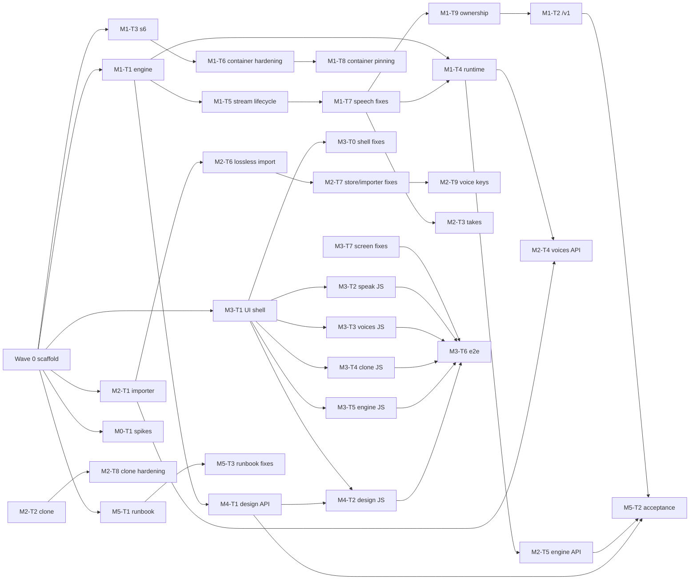

# voxcpm2-openai Implementation Plan

> **For agentic workers:** Use `AGENTS.md` (operating contract) and
> `superpowers:subagent-driven-development`. Executors read this plan, `docs/CONTRACTS.md`, and
> their own brief in `docs/tasks/<ID>.md`. Steps use `- [ ]` in briefs.

**Goal:** One container serving VoxCPM2 via vLLM-Omni behind an OpenAI-compatible
`/v1/audio/speech` API and the six-screen Voice Studio UI, replacing `qwen3-tts-openai`.

**Architecture:** s6 supervises two processes: the vLLM-Omni engine on loopback `:8102` and a
FastAPI app on `:8000`. The app owns voice storage (`/data`), resolves voice names to inline
reference audio, proxies/streams synthesis, re-encodes with ffmpeg, and exposes `/v1`, `/api`,
`/`, `/health`, `/ready`.

**Tech stack:** Python 3.12, FastAPI, uvicorn, httpx, soundfile, numpy, safetensors, ffmpeg,
plain HTML/CSS/ES modules (no build step), pytest + pytest-asyncio, ruff, mypy, GitLab CI.

**Spec:** `SPEC.md` (read-only) + `ui/studio.html` + `ui/tokens.css`.

## Global constraints

- `SPEC.md`, `ui/**`, `deploy/voxcpm2-3090.yaml`, `deploy/compose.yaml` are read-only.
- Python 3.12; no runtime JS dependency except Google Fonts (self-host is allowed).
- 48 kHz mono output default; s16le for `pcm`; OpenAI error shape everywhere on `/v1`.
- Engine concurrency 2, queue 16, then 429 + `Retry-After`.
- No secrets in repo/CI logs; auth is env-driven (`API_KEYS`, `STUDIO_AUTH`).
- No user-supplied text rendered as HTML; no CDN JS; zero border radius; one accent `#FF3B30`.
- Workers never commit; only the lead commits, one conventional commit per task ID.

## Review focus (spec-implied failure modes)

1. **Streaming vs non-streaming parity** — same input must yield the same duration/format; the
   spec measured 7.69 s streamed vs 5.76 s WAV. Pin normalization to s16le at the requested rate.
2. **Voice-name resolution** — case-insensitive, unknown names return 400 *listing valid names*,
   ad-hoc `ref_audio` must bypass the store without poisoning the data-URI cache.
3. **Queue semantics** — 2 run + 16 wait; 429 only for the 19th+; queued requests must not
   silently time out; metrics count queued time as RTF? (no: RTF is engine time).
4. **Consent + upload validation** — type by decoding audio, not extension; 3–30 s; 20 MB cap;
   `consent=true` required or 400.
5. **Path/name safety** — `voice` and take ids are filesystem keys; reject traversal and enforce
   `[a-z0-9][a-z0-9_-]{0,63}` before touching disk.

## Milestones

| ID | Milestone | Exit criteria | Proving CI job |
|---|---|---|---|
| M0 | Spikes S1–S6 | Findings appended to `NOTES.md` with command output from the `vllm` host | `spikes` (manual, host-run) |
| M1 | Engine + `/v1` | `/v1/audio/speech` (all formats, stream), models, voices, warm-up, queueing, OpenAI errors; unit+integration green | `test`, `e2e` |
| M2 | Voice store + Studio API | voices CRUD/import/clone/transcribe/takes/engine status; data survives restart; backups written | `test` |
| M3 | UI | All six screens wired, hash routing, waveforms, tokens and layout match `ui/studio.html`; keyboard-only pass | `e2e` |
| M4 | Design flow | description → 1–4 candidates → select → save → voice usable by name | `test`, `e2e` |
| M5 | Delivery + cutover | CI image build, runbook/rollback documented, acceptance suite exists | CI `build` |

M0 is **BLOCKED-EXTERNAL** in this environment: no VoxCPM2 engine is reachable and the local GPU
is not the `vllm` 3090 host. Scripts + `NOTES.md` are delivered; the milestone cannot be marked
green without running them there (Q-001).

## Requirements inventory

Citations are `SPEC.md` section/line. IDs are append-only.

| ID | Requirement | Source |
|---|---|---|
| R-001 | One container: engine + app; engine binds `127.0.0.1` only; app is the only public surface | §3 L43–64 |
| R-002 | App resolves voice names to reference audio+transcript, forwards to engine, re-encodes, streams through | §3 L62–63 |
| R-003 | Suggested stack: Python 3.12, FastAPI, httpx, soundfile+numpy, ffmpeg, safetensors; no CDN except fonts | §3 L65 |
| R-004 | s6 `engine` service runs the documented `vllm serve … --omni` command | §4 L69 |
| R-005 | Poll engine `/health`, then warm-up (one non-streamed + one streamed synth); `/ready` 200 only after warm-up | §4 L70 |
| R-006 | `POST /api/engine/warmup` re-runs warm-up; `POST /api/engine/restart` restarts s6 engine then warms | §4 L71 |
| R-007 | Engine accepts 2 seqs; app limits to 2 concurrent, bounded queue 16, then 429 + `Retry-After` | §4 L72 |
| R-008 | Engine metrics: VRAM via `nvidia-smi -i 0`; RTF + first-audio rolling average of last 20 | §4 L73 |
| R-009 | `/data` layout: `voices/<name>.safetensors`, `voices.json`, `takes/<id>.wav`+`.json`, `backups/`, `settings.json` | §5 L79–86 |
| R-010 | Voice safetensors: float32 mono tensor `audio`, metadata keys, unique `[a-z0-9][a-z0-9_-]{0,63}` name | §5 L88–108 |
| R-011 | ~~Qwen3 import~~ **Superseded by SPEC v0.2.0:** no import; voices are created in the Studio (Clone/Design) | §5 |
| R-012 | Resolve voice audio+`ref_text` → WAV data URI cached by name+mtime | §6 L142 |
| R-013 | `POST /v1/audio/speech` fields: model(any, required), input(required ≤4000), voice(required, case-insens), response_format, stream, instructions, speed 0.5–2.0, sample_rate, ref_audio/ref_text, cfg/steps/seed | §6 L127–140 |
| R-014 | Unknown voice → 400 listing valid names; ad-hoc `ref_audio`/`ref_text` bypass store | §6 L133,139 |
| R-015 | Content types for wav/pcm/mp3/opus/flac + headers `X-Voice`, `X-Sample-Rate`, `X-Audio-Duration` (non-stream), `X-RTF` (non-stream) | §6 L144 |
| R-016 | Streaming: pcm raw s16le, wav with header, mp3/opus via ffmpeg pipe; normalize streamed output to s16le at requested rate | §6 L135, §12 S3 |
| R-017 | `speed`: native if available else ffmpeg `atempo` non-streamed; ignore for streams (log once) | §6 L137 |
| R-018 | `sample_rate` resamples output (22050/24000 for Wyoming), default 48000 | §6 L138 |
| R-019 | `cfg`/`steps`/`seed` pass through if supported, else ignore (S4) | §6 L140, §12 S4 |
| R-020 | OpenAI error shape `{error:{message,type,param,code}}`; 400/401/429 + Retry-After/503 + Retry-After | §6 L146 |
| R-021 | `GET /v1/models` one entry id `voxcpm2` plus aliases `tts-1`, `openbmb/VoxCPM2` | §6 L150 |
| R-022 | `GET /v1/audio/voices` → `{voices:[{name,language,source}]}` | §6 L151 |
| R-023 | Qwen3 shim compatibility: accept/ignore `task_type`; all existing voice names keep working | §6 L153–155, S6 |
| R-024 | Studio API route table exactly as §7 (voices CRUD/audio/clone/import/transcribe/speak/takes/wave/save-as-voice/design/engine/ready/health) | §7 L161–181 |
| R-025 | Clone: multipart 3–30 s, ≤20 MB, mono, trim silence, peak −1 dBFS, keep original rate ≤48 kHz, `consent=true` required | §7 L167, §10 L247–248 |
| R-026 | `POST /api/transcribe`: multipart file → `{text}` via `STT_URL` OpenAI transcriptions; disabled when unset | §7 L169, §8 L214 |
| R-027 | `/api/speak` same fields as `/v1` + saves take; stream returns stream and saves take when it ends | §7 L170 |
| R-028 | Takes newest first, keep last 50 by default; `GET /api/takes/{id}/wave` → 72 RMS buckets 0..1 | §7 L171–175 |
| R-029 | Design: `candidates` n 1–4 → seed+audio+wave; `save` sets `source=designed`, `ref_text=sample_text`, `design_prompt`, `design_seed` | §7 L176–177 |
| R-030 | `GET /api/engine` status fields: ready/model/versions/GPU/VRAM/KV/max concurrency/rolling RTF+latency/voice count/queue depth | §7 L178 |
| R-031 | `/ready` readiness (engine warm), `/health` liveness | §7 L181 |
| R-032 | UI global: header mark/title/meta with live engine text, 5 hash-routed tabs with 2 px underline, 1280 px/32 px layout, two columns, 112 px label rows | §8 L187–192 |
| R-033 | Speak: chips single-select + localStorage last voice, 13 px text/style, CFG/steps/format, stream toggle, Generate + Ctrl/Cmd+Enter, generating state, streaming playback, takes column, inline errors | §8 L194–201 |
| R-034 | Voices: table columns, search+language filters, inline edit row, in-place delete confirm, header buttons, empty state | §8 L203–209 |
| R-035 | Clone: drop zone + drag-over, 3–30 s client check, auto-transcribe (disabled w/o STT_URL), live name validation, consent gate, Test a line, 3 side notes | §8 L211–217 |
| R-036 | Design: description 15 px, descriptor tags, language, candidate count, sample line, candidate list with seed/play/wave/select, single selection indicator, name+save gating | §8 L219–223 |
| R-037 | Engine: 8-stat grid refreshed every 5 s while visible, warm-up, in-place restart confirm, endpoint example | §8 L225–229 |
| R-038 | Waveforms: single smooth mirrored SVG path, `300×24` viewBox, `preserveAspectRatio="none"`, `wavePath(amps)` from real 72-bucket RMS; not bars | §8 L231–233 |
| R-039 | Accessibility: real buttons/labels, `aria-pressed`, `aria-current="page"`, 2 px focus ring, ≥4.5:1, reduced motion | §8 L235–237 |
| R-040 | `ui/tokens.css` is source of truth: dark `#0E0E0E`, accent `#FF3B30`, Inter Tight + IBM Plex Mono, 0 radius, lines not cards, control heights 34/32/28/24 | §9 L239–241 |
| R-041 | `STUDIO_AUTH` basic auth on `/`, `/api/*`; `API_KEYS` bearer on `/v1/*`; `/ready`,`/health` open | §10 L245–246 |
| R-042 | Store `consent`; designed voices use `own-generated-voice` | §10 L247 |
| R-043 | Upload limits: 20 MB, audio only (decode with soundfile), 3–30 s | §10 L248 |
| R-044 | Never execute/render user text as HTML | §10 L249 |
| R-045 | Build/push `harbor.dotslash.io/dotslash/voxcpm2-openai:0.1.0`, run on 8881, acceptance, cutover to 8880, rollback runbook | §11 L251–258 |
| R-046 | Spikes S1–S6 with findings in `NOTES.md`; adjust design on failure | §12 L260–269 |
| R-047 | Acceptance criteria: WAV 48 kHz RTF ≤0.2, streamed first chunk ≤300 ms, 8 voices, warm start, clone+design flows, LiteLLM/Open WebUI/Hermes/Wyoming, VRAM ≤10 GB, concurrency, UI parity + keyboard | §13 L271–282 |
| R-048 | Milestones M0–M5 | §14 L284–291 |
| R-049 | **Human decision 2026-11-02:** CI builds/pushes the container image only; all quality gates (format/lint/types/tests+coverage/e2e/build/package contract) live in `scripts/verify.sh` | delivery brief |
| R-050 | **Human 2026-11-03:** tag-triggered deploy to `vllm` directly with `DEPLOY_SSH_KEY` (runner → root@vllm), image tag in `/opt/voxcpm2-openai/.env`, podman-compose recreate; branch pushes never deploy | delivery brief |
| R-051 | No secrets in repo or CI logs | delivery brief, §10 |
| R-052 | Startup page at `/` until warm, with 4-step progress, live log, failure mapping | `ui/STARTING.md` |
| R-053 | `/api/engine/startup` contract + `/api` 503 gate with startup/restart exceptions | `ui/STARTING.md` |
| R-054 | Languages store (`languages.json`), supported set file, management API, preset editing, voice relabel/delete rules, drift flag | SPEC §5a/§7 |

## Ambiguities and decisions

| ID | Question | Default chosen (unless human overrides) | Needs human? |
|---|---|---|---|
| Q-001 | S1–S6 need a running engine on `vllm`; none reachable here | Ship spike scripts + `NOTES.md`; implement documented fallbacks; mark M0 BLOCKED-EXTERNAL | **yes**: run spikes on host |
| Q-002 | How does VoxCPM2 voice design reach the engine (S2)? | Try `ref_audio`-less request with `instructions=description` + `seed`; candidate audio cached under `takes/`; isolate behind `app/design.py` so a `voxcpm` worker can replace it | yes (S2) |
| Q-003 | Streaming sample type/rate (S3): spec's 7.69 s vs 5.76 s mismatch | Engine emits s16le 48 kHz; app re-chunks, trims trailing silence only for non-streamed takes, documents measured delta | yes (S3) |
| Q-004 | Are `cfg`/`steps`/`seed` accepted per request (S4)? | Send as extra JSON fields; if engine 422s, retry once without them and log once. UI keeps controls (spec says hide only if S4 fails) | yes (S4) |
| Q-005 | Exact whisper-stt base URL/path | `STT_URL` treated as an OpenAI base ending in `/v1`; POST `{STT_URL}/audio/transcriptions`; disabled when empty | **yes**: verify URL |
| Q-006 | `/api/speak` streaming response has no take metadata | Return audio stream with `X-Take-Id`; take appears in `/api/takes` when complete | no |
| Q-007 | Where design candidate audio lives | `takes/` with `kind=design`, same retention; saved voice copies audio | no |
| Q-008 | Take retention scope "session" | Global newest-50 on disk; UI labels "This session" as in reference | no |
| Q-009 | "Test a line" endpoint | Client calls `POST /v1/audio/speech` with `ref_audio` data URI + `ref_text` (no save); no new route | no |
| Q-010 | Voice rename semantics | Rename file+metadata+index, backup first; takes keep old voice label | no |
| Q-011 | Models payload shape beyond ids | OpenAI-shaped `{object:"list",data:[{id,object:"model",created,owned_by:"openbmb"}]}` with **one** entry `voxcpm2`; aliases accepted on input, not listed | no |
| Q-012 | `speed` + `pcm` + stream together | Allowed; engine ignores native speed for stream, app logs once; no ffmpeg for pcm stream | no |
| Q-013 | Does `API_KEYS` guard `/v1/audio/voices`? | Yes: every `/v1/*` path except `/ready`,`/health` | no |
| Q-014 | Warm-up audio when library empty | Bundled `app/assets/warmup.wav` (1.5 s tone, `ref_text="Warm-up."`), documented as non-speech placeholder | yes: supply real clip optional |
| Q-015 | Container build in GitLab runner | `package` job uses `docker build` (runner must have docker); locally unverified, allowed `when: manual` only if runner lacks it — decided in M5 | yes: runner capability |
| Q-016 | 20-request burst vs 18-slot capacity | 2 active + 16 queued = 18; requests 19–20 get 429 with `Retry-After: 1` | no |
| Q-017 | Take `wave` before audio finishes (stream) | 404 until WAV written; UI polls once | no |
| Q-018 | `instructions` unsupported (S1) | Accept and ignore with one warning log; UI keeps field per spec fallback | yes (S1) |
| Q-019 | Language filter labels vs codes | API codes `en|ja|ko|zh`; UI shows English/Japanese/Korean/Chinese; unknown code shown as-is | no |
| Q-020 | `ref_audio` URL fetch SSRF | Only `data:` URIs and `http(s)` URLs; URL fetch disabled unless `ALLOW_REMOTE_REF_AUDIO=1` (default off) | no |
| Q-021 | Uploaded clone audio >48 kHz | Resample down to 48 kHz; below stays at original rate (spec: "resample to 48 kHz if above") | no |
| Q-022 | Backup retention | Keep newest 20 zips, prune oldest | no |
| Q-024 | Studio Format control vs `/api/speak` returning take metadata (SPEC §7) while takes are WAV (SPEC §5) | **Resolved by human 2026-11-02:** Format drives the `save=false` preview and take playback via `/api/takes/{id}/audio?format=`; stored takes stay 48 kHz WAV | no |
| Q-026 | SPEC §8 still says “Auto-transcribe with whisper-stt”; human requested “Transcribe with STT” | Use the human’s copy; spec wording is superseded for the button label | no |
| Q-025 | Are models aliases list entries or request-only? | **Superseded by SPEC §6:** one entry `voxcpm2`; aliases are request-only (matches Q-011) | no |
| Q-023 | "Test a line" needs `/v1`, which requires Bearer when `API_KEYS` is set; the browser has no key | **Resolved by human 2026-11-02:** Studio preview/test synthesis uses `POST /api/speak?save=false` under Studio Basic auth; no bearer key, button never disabled | no |

## Task graph

Wave 0 is the lead scaffold (contracts + tooling). A task is ready only when every `deps:` entry is
`pass` and its `owns:` globs are disjoint from the rest of its wave.

| ID | M | Wave | Title | owns | deps | verify |
|---|---|---|---|---|---|---|
| M0-T1 | M0 | 1 | Spike scripts + NOTES | `scripts/spikes/**`, `NOTES.md` | — | `.venv/bin/python -m compileall -q scripts/spikes` |
| M1-T1 | M1 | 1 | Engine client (queue, metrics, health, restart) | `app/engine.py`, `tests/test_engine.py` | — | `.venv/bin/python -m pytest tests/test_engine.py -q` |
| M1-T3 | M1 | 1 | s6 services + Containerfile wiring | `deploy/s6/**`, `deploy/Containerfile`, `tests/test_deploy.py` | — | `.venv/bin/python -m pytest tests/test_deploy.py -q` |
| M1-T5 | M1 | 2 | Streaming admission + lifecycle (review) | `app/engine.py`, `app/speech.py`, `tests/test_engine.py`, `tests/test_stream_lifecycle.py` | M1-T1 | `.venv/bin/python -m pytest tests/test_engine.py tests/test_stream_lifecycle.py -q` |
| M1-T6 | M1 | 2 | Container hardening (review) | `deploy/Containerfile`, `tests/test_deploy.py` | M1-T3 | `.venv/bin/python -m pytest tests/test_deploy.py -q` |
| M2-T6 | M2 | 2 | Lossless import metadata (review) | `app/store.py`, `app/importer.py`, `tests/test_store.py`, `tests/test_importer.py` | M2-T1 | `.venv/bin/python -m pytest tests/test_store.py tests/test_importer.py -q` |
| M3-T0 | M3 | 2 | UI shell fixes (review) | `app/static/index.html`, `app/static/studio.css`, `app/static/js/core.js`, `tests/test_ui_assets.py` | M3-T1 | `.venv/bin/python -m pytest tests/test_ui_assets.py -q` |
| M5-T3 | M5 | 2 | Runbook/smoke/spike fixes (review) | `docs/RUNBOOK.md`, `scripts/smoke.sh`, `scripts/spikes/**`, `NOTES.md` | M0-T1, M5-T1 | `bash -n scripts/smoke.sh && .venv/bin/python -m compileall -q scripts/spikes` |
| M2-T1 | M2 | 1 | Qwen3 voice importer | `app/importer.py`, `tests/test_importer.py` | — | `.venv/bin/python -m pytest tests/test_importer.py -q` |
| M3-T1 | M3 | 1 | UI shell: index.html + CSS + core.js | `app/static/index.html`, `app/static/studio.css`, `app/static/js/core.js` | — | `.venv/bin/python -m pytest tests/test_ui_assets.py -q` |
| M5-T1 | M5 | 1 | Runbook + smoke script | `docs/RUNBOOK.md`, `scripts/smoke.sh` | — | `bash -n scripts/smoke.sh` |
| M1-T9 | M1 | 4 | StreamingSpeech ownership/cancel fixes (review) | `app/engine.py`, `app/speech.py`, `tests/test_speech.py`, `tests/test_stream_lifecycle.py` | M1-T7 | `.venv/bin/python -m pytest tests/test_speech.py tests/test_stream_lifecycle.py -q` |
| M2-T9 | M2 | 4 | Voice key + case-safe scan + cache cap (review) | `app/store.py`, `tests/test_store.py` | M2-T7 | `.venv/bin/python -m pytest tests/test_store.py -q` |
| M3-T7 | M3 | 4 | Screen contract/lifecycle fixes (review) | `app/static/index.html`, `app/static/js/**`, `tests/test_ui_assets.py` | M3-T2…T5, M4-T2 | `.venv/bin/python -m pytest tests/test_ui_assets.py -q` |
| M1-T10 | M1 | 5 | Warm-up ordering + voice 400 + shutdown (review) | `app/speech.py`, `app/warmup.py`, `app/main.py`, `tests/test_speech.py`, `tests/test_warmup.py` | M1-T4, M1-T9 | `.venv/bin/python -m pytest tests/test_speech.py tests/test_warmup.py -q` |
| M2-T10 | M2 | 5 | Store rebuild test correctness (review) | `tests/test_store.py` | M2-T9 | `.venv/bin/python -m pytest tests/test_store.py -q` |
| M3-T8 | M3 | 5 | Clone gating + status styling (review) | `app/static/js/clone.js`, `app/static/index.html`, `app/static/studio.css`, `tests/test_ui_assets.py` | M3-T7 | `.venv/bin/python -m pytest tests/test_ui_assets.py -q` |
| M1-T13 | M1 | 8 | CI/verify parity, auth fail-fast, 500 shape (review) | `.gitlab-ci.yml`, `scripts/verify.sh`, `app/config.py`, `app/main.py`, `tests/test_config.py`, `tests/test_auth.py` | M1-T11, M1-T12, M2-T11 | `.venv/bin/python -m pytest tests/test_config.py tests/test_auth.py -q` |
| M1-T14 | M1 | 8 | One models card, instructions fallback, upstream 429/503, header safety (review) | `app/models.py`, `app/engine.py`, `app/routers/v1.py`, `tests/test_v1.py`, `tests/test_engine.py` | M1-T12 | `.venv/bin/python -m pytest tests/test_v1.py tests/test_engine.py -q` |
| M1-T15 | M1 | 8 | Speech off-loop decode/transcode (review) | `app/speech.py`, `tests/test_speech.py` | M1-T9, M1-T12 | `.venv/bin/python -m pytest tests/test_speech.py -q` |
| M2-T12 | M2 | 8 | Store metadata-only list, unique backups, take invariants (review) | `app/store.py`, `app/routers/studio_takes.py`, `tests/test_store.py`, `tests/test_studio_takes.py` | M2-T9, M2-T11 | `.venv/bin/python -m pytest tests/test_store.py tests/test_studio_takes.py -q` |
| M2-T13 | M2 | 8 | Deterministic burst + host RTF evidence (review) | `tests/fake_engine.py`, `tests/test_acceptance.py`, `scripts/smoke.sh`, `docs/RUNBOOK.md` | M5-T2 | `.venv/bin/python -m pytest tests/test_acceptance.py -q` |
| M3-T10 | M3 | 8 | Disabled affordance, streaming/clone e2e, 390 parity (review) | `app/static/index.html`, `app/static/studio.css`, `app/static/js/speak.js`, `app/static/js/voices.js`, `app/static/js/design.js`, `tests/test_ui_assets.py`, `tests/e2e/**` | M3-T6, M3-T9 | `.venv/bin/python -m pytest tests/e2e -q` |
| M2-T14 | M2 | 9 | Studio preview via `/api/speak?save=false` + take formats (human) | `app/models.py`, `app/routers/studio_takes.py`, `tests/test_studio_takes.py` | M2-T12 | `.venv/bin/python -m pytest tests/test_studio_takes.py -q` |
| M5-T4 | M5 | 9 | Align CI/CD with notely conventions + STT URL (human) | `.gitlab-ci.yml`, `docs/RUNBOOK.md`, `tests/test_deploy.py` | M1-T13 | `.venv/bin/python -m pytest tests/test_deploy.py -q` |
| M5-T5 | M5 | 21 | Auto-deploy to vllm via jumpbox + .env image | `.gitlab-ci.yml`, `deploy/compose.yaml`, `docs/RUNBOOK.md`, `tests/test_deploy.py` | M5-T4 | `pytest tests/test_deploy.py` |
| M3-T11 | M3 | 10 | Studio preview UI + real Format control (human) | `app/static/js/clone.js`, `app/static/js/speak.js`, `app/static/index.html`, `tests/test_ui_assets.py`, `tests/e2e/**` | M2-T14 | `.venv/bin/python -m pytest tests/e2e -q` |
| M2-T15a | M2 | 11 | Engine log runner + s6 wiring | `app/engine_runner.py`, `deploy/s6/engine/run`, `tests/test_engine_runner.py`, `tests/test_deploy.py` | M1-T3 | `pytest tests/test_engine_runner.py tests/test_deploy.py` |
| M3-T12 | M3 | 11 | Startup page asset + Engine stat cosmetics | `app/static/starting.html`, `app/static/index.html`, `app/static/studio.css`, `app/static/js/engine.js`, `tests/test_ui_assets.py`, `tests/e2e/test_studio.py` | M3-T10 | `pytest tests/e2e` |
| M2-T15b | M2 | 12 | Startup tracker + `/api/engine/startup` + routing | `app/startup.py`, `app/main.py`, `app/routers/studio_engine.py`, `tests/test_startup.py`, `tests/e2e/test_startup.py` | M2-T15a, M3-T12 | `pytest tests/test_startup.py tests/e2e/test_startup.py` |
| M2-T16 | M2 | 13 | Startup state/gate/RTF fixes (review) | `app/startup.py`, `app/main.py`, `app/warmup.py`, `app/engine.py`, `app/routers/studio_engine.py`, `tests/test_startup.py`, `tests/test_warmup.py`, `tests/test_engine.py` | M2-T15b | `pytest tests/test_startup.py tests/test_warmup.py tests/test_engine.py` |
| M2-T17 | M2 | 13 | Runner log safety + s6 backoff (review) | `app/engine_runner.py`, `deploy/s6/engine/finish`, `deploy/s6/engine/run`, `tests/test_engine_runner.py`, `tests/test_deploy.py` | M2-T15a | `pytest tests/test_engine_runner.py tests/test_deploy.py` |
| M3-T13 | M3 | 13 | Startup UX + ready-path e2e (review) | `app/static/starting.html`, `app/static/index.html`, `app/static/js/engine.js`, `tests/test_ui_assets.py`, `tests/e2e/test_startup.py` | M2-T15b, M3-T12 | `pytest tests/e2e/test_startup.py` |
| M2-T18 | M2 | 14 | Remove Qwen3 import (spec v0.2.0) | `app/importer.py`, `app/main.py`, `app/routers/studio_voices.py`, `deploy/compose.yaml`, `tests/test_importer.py`, `tests/test_studio_voices.py`, `tests/test_acceptance.py`, `tests/test_deploy.py` | M2-T4 | `pytest tests/test_studio_voices.py tests/test_acceptance.py` |
| M1-T18 | M1 | 14 | Empty library 400 + warm-only synthesis/metrics | `app/config.py`, `app/speech.py`, `app/routers/v1.py`, `app/routers/studio_takes.py`, `tests/conftest.py`, `tests/test_v1.py`, `tests/test_studio_takes.py`, `tests/test_speech.py`, `tests/test_metrics.py` | M1-T12, M2-T16 | `pytest tests/test_metrics.py tests/test_v1.py` |
| M3-T14 | M3 | 14 | Presets, empty states, icons, startup log table | `app/static/index.html`, `app/static/starting.html`, `app/static/studio.css`, `app/static/js/speak.js`, `app/static/js/voices.js`, `app/static/js/design.js`, `app/static/presets.json`, `app/static/icons/**`, `tests/test_ui_assets.py`, `tests/e2e/*` | M3-T13 | `pytest tests/e2e` |
| M2-T20 | M2 | 17 | Languages store + management API + voice enforcement | `app/languages.py`, `app/routers/languages.py`, `app/main.py`, `app/config.py`, `deploy/supported-languages.json`, `deploy/Containerfile`, voice routers, `app/design.py`, `tests/test_languages.py`, related tests | M2-T5, M2-T18 | `pytest tests/test_languages.py` |
| M3-T16 | M3 | 18 | Languages screen + language-aware Studio | `app/static/index.html`, `app/static/studio.css`, `app/static/js/core.js`, `app/static/js/languages.js`, `app/static/js/speak.js`, `app/static/js/clone.js`, `app/static/js/design.js`, `app/static/js/voices.js`, `app/static/icons/**`, `tests/test_ui_assets.py`, `tests/e2e/test_studio.py` | M2-T20 | `pytest tests/e2e` |
| M1-T20 | M1 | 19 | Engine stream WAV/format/rate normalization | `app/engine.py`, `app/speech.py`, `tests/fake_engine.py`, stream tests | M1-T9 | `pytest tests/test_streaming.py` |
| M2-T21 | M2 | 20 | Session-scoped takes | `app/routers/studio_takes.py`, `tests/test_studio_takes.py` | M2-T12 | `pytest tests/test_studio_takes.py` |
| M3-T17 | M3 | 19 | Player/editor/session/tab fixes | `app/static/js/core.js`, `speak.js`, `voices.js`, `clone.js`, `index.html`, `studio.css`, UI/e2e tests | M3-T14 | `pytest tests/e2e` |
| M4-T3 | M4 | 19 | Voice design/style control syntax | `app/design.py`, `app/speech.py`, `tests/test_design.py` | M4-T1 | `pytest tests/test_design.py` |
| M1-T2 | M1 | 5 | `/v1` API (speech, models, voices) | `app/routers/v1.py`, `tests/test_v1.py`, `tests/test_streaming.py` | M1-T1 | `.venv/bin/python -m pytest tests/test_v1.py tests/test_streaming.py -q` |
| M1-T4 | M1 | 4 | Startup/warm-up/readiness wiring | `app/warmup.py`, `app/main.py`, `tests/test_warmup.py` | M1-T1 | `.venv/bin/python -m pytest tests/test_warmup.py -q` |
| M2-T2 | M2 | 2 | Clone + transcribe API | `app/routers/studio_clone.py`, `tests/test_studio_clone.py` | — | `.venv/bin/python -m pytest tests/test_studio_clone.py -q` |
| M2-T3 | M2 | 5 | Speak + takes API | `app/routers/studio_takes.py`, `tests/test_studio_takes.py` | — | `.venv/bin/python -m pytest tests/test_studio_takes.py -q` |
| M4-T1 | M4 | 2 | Design candidates/save backend | `app/design.py`, `app/routers/studio_design.py`, `tests/test_design.py` | M1-T1 | `.venv/bin/python -m pytest tests/test_design.py -q` |
| M2-T4 | M2 | 5 | Voices CRUD + import route | `app/routers/studio_voices.py`, `tests/test_studio_voices.py` | M2-T1, M1-T4 | `.venv/bin/python -m pytest tests/test_studio_voices.py -q` |
| M2-T5 | M2 | 5 | Engine status/warmup/restart API | `app/routers/studio_engine.py`, `tests/test_studio_engine.py` | M1-T4 | `.venv/bin/python -m pytest tests/test_studio_engine.py -q` |
| M1-T7 | M1 | 3 | Engine/speech slot-leak + error-shape fixes (review) | `app/engine.py`, `app/speech.py`, `tests/test_engine.py`, `tests/test_stream_lifecycle.py`, `tests/test_speech.py` | M1-T5 | `.venv/bin/python -m pytest tests/test_engine.py tests/test_stream_lifecycle.py tests/test_speech.py -q` |
| M1-T8 | M1 | 3 | Container pinning + stale-service guard (review) | `deploy/Containerfile`, `tests/test_deploy.py` | M1-T6 | `.venv/bin/python -m pytest tests/test_deploy.py -q` |
| M2-T7 | M2 | 3 | Store/importer key + backup safety (review) | `app/store.py`, `app/importer.py`, `tests/test_store.py`, `tests/test_importer.py` | M2-T6 | `.venv/bin/python -m pytest tests/test_store.py tests/test_importer.py -q` |
| M2-T8 | M2 | 3 | Clone/STT + audio timeout hardening (review) | `app/routers/studio_clone.py`, `app/audio.py`, `tests/test_studio_clone.py`, `tests/test_audio.py` | M2-T2 | `.venv/bin/python -m pytest tests/test_studio_clone.py tests/test_audio.py -q` |
| M3-T2 | M3 | 3 | Speak screen JS | `app/static/js/speak.js` | M3-T1 | `.venv/bin/python -m pytest tests/test_ui_assets.py -q` |
| M3-T3 | M3 | 3 | Voices screen JS | `app/static/js/voices.js` | M3-T1 | `.venv/bin/python -m pytest tests/test_ui_assets.py -q` |
| M3-T4 | M3 | 3 | Clone screen JS | `app/static/js/clone.js` | M3-T1 | `.venv/bin/python -m pytest tests/test_ui_assets.py -q` |
| M3-T5 | M3 | 3 | Engine screen JS | `app/static/js/engine.js` | M3-T1 | `.venv/bin/python -m pytest tests/test_ui_assets.py -q` |
| M4-T2 | M4 | 3 | Design screen JS | `app/static/js/design.js` | M3-T1, M4-T1 | `.venv/bin/python -m pytest tests/test_ui_assets.py -q` |
| M1-T11 | M1 | 6 | Restart/warm-up supervision + HTTP 429 (review) | `app/engine.py`, `app/warmup.py`, `app/routers/system.py`, `tests/test_warmup.py`, `tests/test_studio_engine.py`, `tests/test_queue_http.py` | M2-T5, M1-T10 | `.venv/bin/python -m pytest tests/test_warmup.py tests/test_studio_engine.py tests/test_queue_http.py -q` |
| M1-T12 | M1 | 6 | Models aliases, ASCII headers, error shape (review) | `app/models.py`, `app/speech.py`, `app/routers/v1.py`, `app/main.py`, `tests/test_v1.py` | M1-T2 | `.venv/bin/python -m pytest tests/test_v1.py -q` |
| M2-T11 | M2 | 6 | Take language/48 kHz/FLAC + auth tests (review) | `app/routers/studio_takes.py`, `app/audio.py`, `tests/test_studio_takes.py`, `tests/test_auth.py` | M2-T3, M1-T10 | `.venv/bin/python -m pytest tests/test_studio_takes.py tests/test_auth.py -q` |
| M3-T9 | M3 | 6 | Clone fail-closed gate + Format hint (review) | `app/static/js/clone.js`, `app/static/js/speak.js`, `app/static/index.html`, `app/static/studio.css`, `tests/test_ui_assets.py` | M3-T8 | `.venv/bin/python -m pytest tests/test_ui_assets.py -q` |
| M3-T6 | M3 | 7 | UI e2e + parity harness | `tests/e2e/**` | M3-T2..T5, M4-T2 | `.venv/bin/python -m pytest tests/e2e -q` |
| M5-T2 | M5 | 7 | Acceptance suite (spec §13) | `tests/test_acceptance.py` | M1-T2, M2-T5, M4-T1 | `.venv/bin/python -m pytest tests/test_acceptance.py -q` |

## Waves

- **Wave 0 — scaffold (lead):** package/config, models, errors, audio, store, speech service,
  auth, app factory, test fixtures + fake engine, tokens, verify.sh, CI, contracts doc.
- **Wave 1:** M0-T1, M1-T1, M1-T3, M2-T1, M3-T1, M5-T1 (6 parallel).
- **Wave 2 (review fixes):** M1-T5, M1-T6, M2-T6, M3-T0, M5-T3, M2-T2, M4-T1 (7 parallel).
- **Wave 3 (review fixes + UI):** M1-T7, M1-T8, M2-T7, M2-T8, M3-T2, M3-T3, M3-T4, M3-T5, M4-T2 (9 parallel).
- **Wave 4 (review fixes):** M1-T4, M1-T9, M2-T9, M3-T7 (4 parallel).
- **Wave 5:** M1-T2, M2-T3, M2-T4, M2-T5, M1-T10, M2-T10, M3-T8 (7 parallel).
- **Wave 6 (review fixes):** M1-T11, M1-T12, M2-T11, M3-T9 (4 parallel).
- **Wave 7:** M3-T6, M5-T2 (2 parallel).
- **Wave 8 (release review fixes):** M1-T13, M1-T14, M1-T15, M2-T12, M2-T13, M3-T10 (6 parallel).
- **Wave 9:** M2-T14, M5-T4 (2 parallel).
- **Wave 10:** M3-T11.
- **Wave 11:** M2-T15a, M3-T12.
- **Wave 12:** M2-T15b.
- **Wave 13:** M2-T16, M2-T17, M3-T13.
- **Wave 14 (SPEC v0.2.0):** M2-T18, M1-T18, M3-T14; then full `scripts/verify.sh`, tag v0.2.0.

## Dependency DAG

